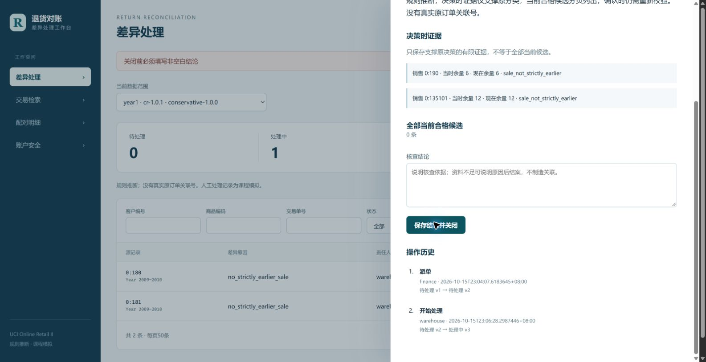
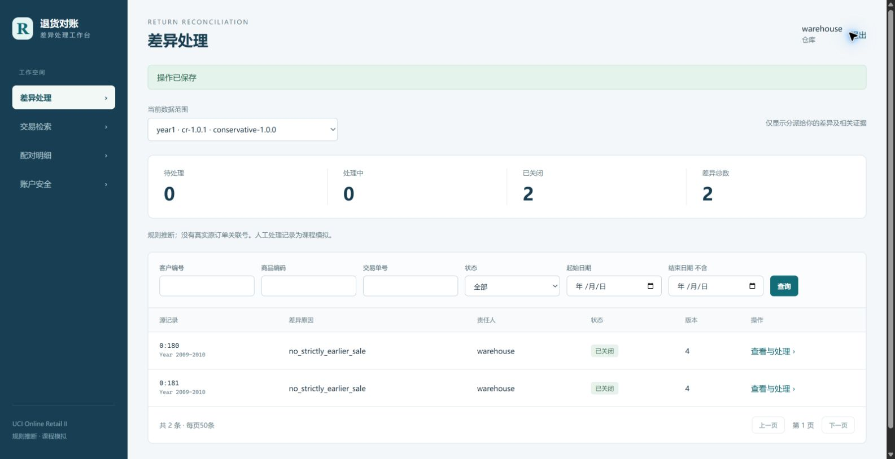
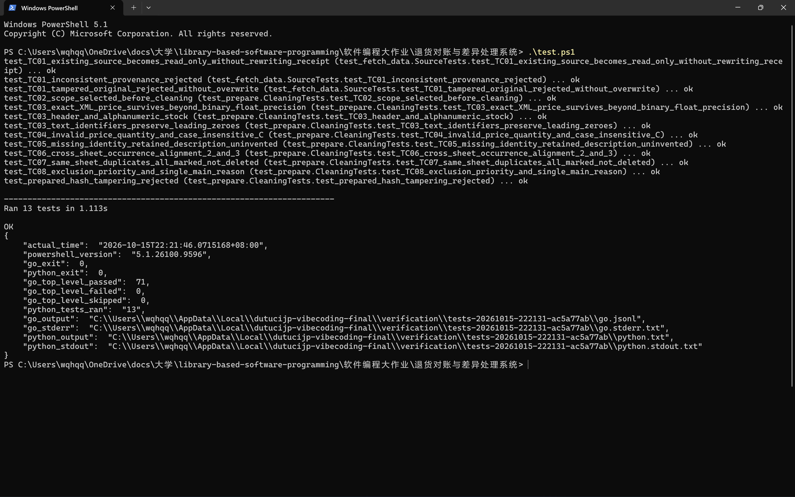

# 项目阶段执行合并报告

更新日期：2026-10-15。已推进到网页业务与浏览器验收阶段；软件整体验收尚未通过，PPT暂停，明天（10-16）继续制作。原10-15至10-17任务已完成，10-18至10-20任务部分完成，10-21收口与冻结尚未完成。
清洗版本：cr-1.0.1；规则版本：conservative-1.0.0。所有提前完成工作均按真实10-15记录。

## 一、任务进度

| 原计划日期 | 任务 | 当前状态 |
| --- | --- | --- |
| 10-15 | 环境、官方数据、清洗、SQLite导入、源行与守恒 | 已完成 |
| 10-16 | 唯一候选配对、部分退货、歧义、精度与幂等 | 已完成 |
| 10-17 | 派单、开始处理、结论关闭、并发唯一及审计 | 已完成，后台反例与网页正常/拒绝流程已验证 |
| 10-18 | 人工确认、强密码、Passkey/TOTP、恢复、角色权限与导出 | 软件实现和自动测试完成；三角色Passkey通过，人工确认及恢复真机待补，TOTP真机本轮跳过 |
| 10-19 | 页面、工程控制、中期制作工具准备 | 页面和构建可用，22张验收截图已保存；技能重启、可信Hook实际拦截和上下文记录待完成 |
| 10-20 | 测试、审查、性能、中期报告/PPT初稿 | 功能回归、独立审查和性能测量已有结果；两项性能未通过，报告/PPT尚未生成 |
| 10-21 | 材料收口、完整预演、白名单打包及冻结 | 尚未完成，不标冻结 |

10-22和11-17继续留空。中期10-21、最终11-16的冻结安排保留；提前完成技术子项不等于其所在整日任务全部完成。

## 二、已完成的软件功能

- 完成benchmark、year1与官方两年度all的准备、导入、来源定位、清洗和行数守恒。
- 按客户、商品、精确价格、国家、在先时间和可退余量保守配对，支持部分退货与累计分配；多候选不等量优先，不跨销售分摊。
- 完成初始派单唯一、责任人开始处理、非空结论关闭、状态/版本冲突拒绝、事务审计，以及人工确认的原子校验和数量约束。
- 实现强密码、Passkey/TOTP、受限恢复、可信会话和角色范围；三个账户均完成首次配置并绑定Passkey，三角色Passkey登录已验证。
- 实现差异/交易/配对页面、条件查询与分页、证据/候选、历史和筛选CSV；仓库仅访问自己的差异及关联信息。
- 完成测试入口的PowerShell 5.1兼容修复；正常stderr不再误报异常，非零退出码仍能识别。

## 三、数据与对账结果

| 指标 | benchmark | year1 | all |
| --- | ---: | ---: | ---: |
| 原始行 | 10000 | 525461 | 1067371 |
| 接纳行 | 9972 | 521770 | 1038818 |
| 排除行 | 28 | 3691 | 28553 |
| 接纳取消行 | 175 | 10205 | 19164 |
| 已配对 | 15 | 5214 | 9714 |
| 疑似 | 7 | 2699 | 6275 |
| 当前规则下无合格原单 | 153 | 2292 | 3175 |
| 差异总数 | 160 | 4991 | 9450 |

各范围均满足原始＝接纳＋排除、接纳取消＝已配对＋疑似＋无合格原单。all原始取消19494＝接纳19164＋排除330。year1配对覆盖率51.092602%，不代表真实关联准确率。

原件只读、散列未变；首表第265行因非正价格排除，八个原始字段一致。文本客户编号保留前导零。买10退4余6、多个合格候选不自动选择、余2退3拒绝，以及同输入重跑不新增差异均已验证。

## 四、浏览器验收与测试

- 71条Go顶层测试＋13条Python测试通过，零失败、零跳过。PowerShell 5.1和7.6.5均已实测；同一套用例不因运行两次重复计数。
- 财务、仓库、管理员的Passkey登录与各自视图已验证；当前三个账户均配置完成，各有1个Passkey。
- 已完成财务派单→仓库开始→填写结论→关闭，并保留三个状态动作的审计。演示库当前4989条待处理、0条处理中、2条已关闭。
- 重复派单显示现有责任人，空结论被服务端拒绝，仓库全局导出及访问未分配证据被拒绝。跳级、逆向、关闭后写入及并发冲突另有自动测试通过。
- 0:1378的合格候选已查看，尚未人工确认，不把查看候选算作确认成功。
- CSV由下载器接管后成功保存，已核对54条，超过单页50条；浏览器下载取消提示不计为软件导出失败。
- 本轮保存22张截图，其中查询等待图只表示等待，结案后的瞬时旧统计不作为最终计数。

## 五、性能结果与验收结论

| 指标 | 实测 | 底线 | 结论 |
| --- | --- | --- | --- |
| NFR-01：一万行完整流程 | 2.001661 / 1.711716 / 1.830999秒 | 每次≤5秒 | 通过 |
| NFR-02：两年度首次完整流程 | 完整首轮198.841174秒，后续未完成样本不计成功 | 三次均≤90秒 | 未通过 |
| NFR-03：已准备全量强制重算 | 14.492502 / 14.864326 / 14.281526秒 | 每次≤15秒 | 底线通过，≤5秒目标未达 |
| NFR-04：重任务中10路并发查询 | 300次中72成功、228失败，P95约30秒 | 零失败且P95≤500毫秒 | 未通过 |

两轮性能优化已用完，本阶段不追加优化，未达标项继续保留。all功能已真实跑通，但不能据此把全量性能标为通过；71＋13条测试通过也不抵消这两项失败。软件整体当前未验收通过。

## 六、问题与处理

已修复并留存复验的问题包括：INSERT参数与列数不一致、依赖取得与原件只读保护缺口、文本客户编号前导零丢失、认证/会话撤销边界、构建与Windows权限配置，以及PowerShell 5.1将正常测试stderr误判异常。首次失败与后续复验均保留，不把预期故障注入当作额外开发问题。

warehouse演示账户的一次性维护重置不计为标准恢复流程通过。当前交易查询等待与并发性能失败继续列为风险，不把等待截图当查询成功。

## 七、剩余工作与暂停点

1. 明天从固定十页中期PPT制作继续，使用已有22张截图及真实结果，保留性能遗留；目前只有模板检查，没有自写PPT、PDF或正式报告成品。
2. 人工候选确认、标准受限恢复及恢复码重复使用拒绝的真机验收待补。TOTP真机按本轮安排跳过，保留实现及自动用例，不写真机通过。
3. 技能重启调用、可信Hook实际deny、上下文记录、用量/费用核对，以及完整汇报预演尚未完成。
4. 正式3至5页中期报告、九类材料收口、白名单包/解包、最终材料版恢复核验、冻结与发送待完成。另一台机器验证仍属最终阶段安排。

当前仅10-14和10-15两个真实工作日期。当天完成的提前任务不补成未来记录，当前未冻结；本轮只更新执行报告、状态与备份，不继续软件测试、开发或PPT制作。

## 八、主要画面

