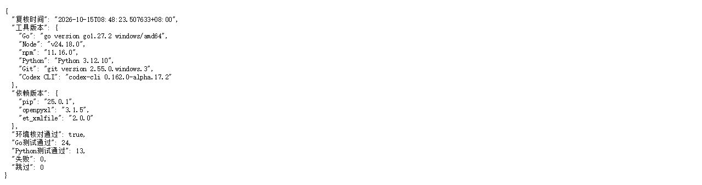
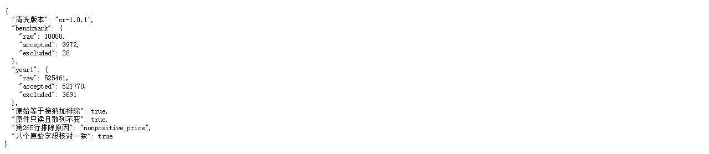
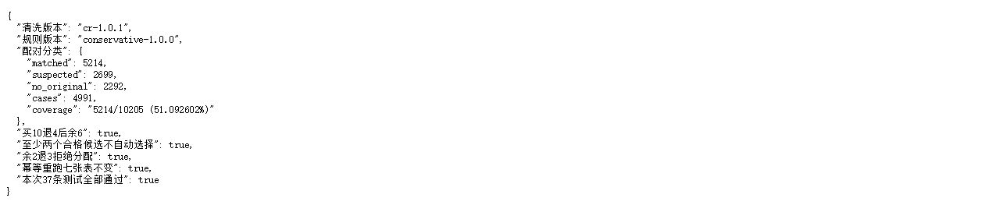

# 10月15日与16日任务执行合并报告

状态：两项计划任务均已完成，范围为首版后台/CLI。实际完成日期：2026-10-15；10月16日任务提前完成。
清洗版本：cr-1.0.1；配对规则版本：conservative-1.0.0。

## 已完成的任务

| 计划日期 | 内容 | 完成结果 |
| --- | --- | --- |
| 10-15 | FR-01至FR-04：环境、官方数据、清洗、导入、源行与守恒 | 必要工具版本核验通过；依赖锁定，原件只读且散列不变；benchmark/year1完成准备、SQLite导入和查询 |
| 10-16 | FR-05、FR-06、FR-08：保守配对、部分退货、歧义与幂等 | 唯一合格候选自动配对；累计分配不超量；多候选保留核查；同输入复用，处理记录保留验证通过 |
| 两项共同复核 | 测试复跑、排除记录、配对案例与截图 | 24条Go顶层测试、13条Python测试通过，零失败、零跳过；环境、数据及三个配对案例复核完成，截图已保存 |

## 数据和配对结果

| 范围 | 原始行 | 接纳行 | 排除行 | 守恒 |
| --- | ---: | ---: | ---: | --- |
| benchmark | 10000 | 9972 | 28 | 10000＝9972＋28 |
| year1 | 525461 | 521770 | 3691 | 525461＝521770＋3691 |

首年度接纳取消10205条＝已配对5214＋疑似2699＋当前规则下无合格原单2292；差异共4991条。配对覆盖率为51.092602%，属于规则推断的覆盖率，不能解释为准确率。

原始取消10206条＝接纳10205＋排除1。主要排除原因分别为非正价格3690条、数量或符号非法1条。质量标记可以交叉，不重复计入排除总数。

首表第265行因非正价格排除，缺客户为附加标记；八个原始字段核对一致。文本客户编号保留前导零，原始字段、表名和行号可以定位。

三个配对案例均已核对：

- 买10退4，分配4，剩余6。
- 存在至少两个合格候选，不自动选择，候选余量不被扣减。
- 余量2、取消数量3，拒绝分配，余额不变。

同输入重跑返回同一运行，七张表的行数和内容未变。隔离测试验证模拟人工处理记录在复跑和重新打开数据库后保留。

数量完全相等不能消除歧义：买4与买10都满足退4时，等量只说明数量足够，不能证明退货对应哪一笔销售。人工核查也不得突破身份、商品、精确价格、国家、在先时间和余量条件。

## 问题与修正

| 问题 | 修正 | 当前结果 |
| --- | --- | --- |
| SQLite INSERT参数数目与列数不一致 | 改为显式列名和正确参数数量 | 数据库测试与首年度导入复验通过 |
| Python依赖此前来自镜像 | 改为官方直链与散列锁定 | 依赖重装与核验通过 |
| 原件未设置系统只读属性 | 设置只读并复验散列 | 原件未改变 |
| 文本客户编号前导零丢失 | 修正文本与数值编号处理，升级cr-1.0.1 | 回归测试与两个数据范围复验通过 |

目标配对用例TC-09至TC-15、TC-18通过，含金额精度和并发幂等分支。数据准备TC-01、TC-03至TC-08在首版CLI/夹具范围通过；TC-02部分覆盖，TC-06的官方all分支尚未验证。

## 后续范围

下一项仍是10月17日派单与状态流转任务。官方两年度全量、页面、认证、人工业务流程、完整导出及正式四项性能指标继续按原计划完成。此次标注只关闭10月15日、16日的首版任务；10月22日和11月17日继续留空，冻结日期不变。

## 复核截图

