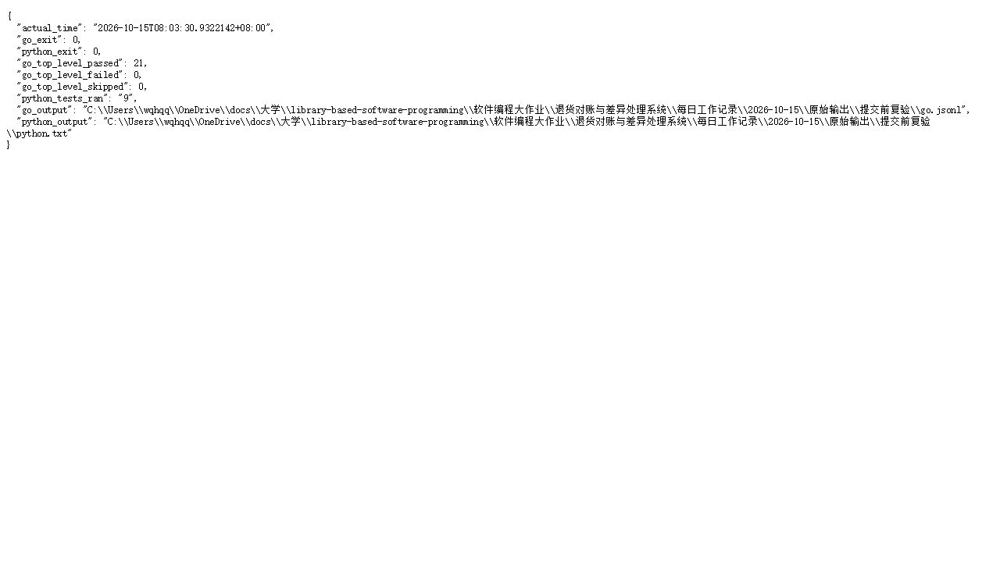
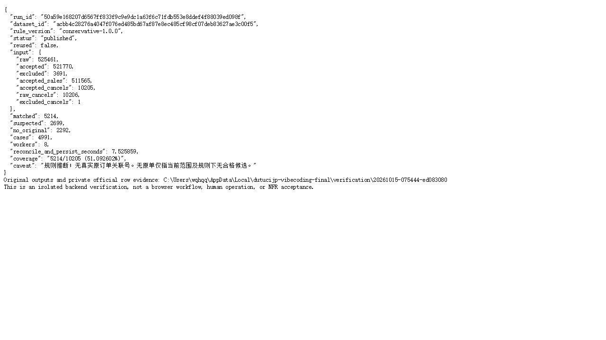

# 2026-10-15真实截图索引

## 最新复核截图

- [环境与测试复核](2026-10-15-03-环境与测试复核.jpg)
- [数据与排除复核](2026-10-15-04-数据与排除复核.jpg)
- [配对与余量复核](2026-10-15-05-配对与余量复核.jpg)

三张最新截图及两项任务完成结果见[合并报告](../10-15与10-16任务执行合并报告.md)。以下两张截图及记录保留为早期批次。

两张图片由Codex在浏览器直接打开现有CLI原始输出后采集，JPEG原图未编辑。不是业务应用页面、终端窗口或本人亲跑截图；不重绘、不补造。只读查看器不改变源文件，采集后关闭，URL仅记录当时入口。

## 1 2026-10-15-01-真实测试输出-浏览器原文.jpg

- 采集时间：2026-10-15T08:14:15.507000+08:00
- 当时入口：http://127.0.0.1:11818/final-tests.txt
- 源文件：每日工作记录/2026-10-15/原始输出/提交前复验/summary.json
- 源文件SHA-256：05d25ad8e4feb36808a6f4b887268f7aa5975c7db75280b93e3ef57295d39824
- 图片尺寸：(1280, 720)
- 图片字节：42658
- 图片SHA-256：ed1c1910de88e44fcca4644bd2cdc6b1f8ce05e58bfec80cdd2e8e912fac1476

## 2 2026-10-15-02-首年度对账输出-浏览器原文.jpg

- 采集时间：2026-10-15T08:14:35.988000+08:00
- 当时入口：http://127.0.0.1:11818/year1-run.txt
- 源文件：每日工作记录/2026-10-15/原始输出/year1复现-修复复验.txt
- 源文件SHA-256：da7884b464f7f239c1b9ec4a0c5fc35aaf756c991128651619357172cb89c4de
- 图片尺寸：(1280, 720)
- 图片字节：57924
- 图片SHA-256：ba500464d0000416f83ceb8d98cc444c75bf02912e8f2ede1bdd396b2f986f46

## 6 2026-10-15-06-修复版安全登录页.png

- 实际采集时间：2026-10-15T21:04:32.3355306+08:00（文件写入时间；CUA实际页面采集）。
- 来源：本执行对话的Codex In-app Browser，http://localhost:8080/，recon-fixed.exe实际登录页。
- 内容：未登录、安全入口、账户与密码空白、两种方式提示。没有初始化链接、二维码、OTP、密码、恢复码或登录后的业务。
- 图片尺寸：(736, 765)；字节：37379；SHA-256：f17ce4d52ce6f4872f12168d522b760b9e2d6d93bd08b116e39528bcc2674aed。
- 原图直接保存，未编辑。仅证明页面已渲染，不能证明本人认证/业务演示或全部软件验收。其余新测试/性能和业务画面待辅导停写后核对采集。

## 2026-10-15 23时Chrome验收补充

[21张Chrome实际画面与1张本人亲跑测试图](FR12-16浏览器验收/截图索引.md)。来源与SHA见原始输出/FR18浏览器与PPT/截图校验.json；代理业务操作与本人Passkey/测试分开。图08等待、图15瞬时旧统计不报最终成功；CSV下载器接管已核对。PPT按本人最新要求暂停，尚无自写成品。
