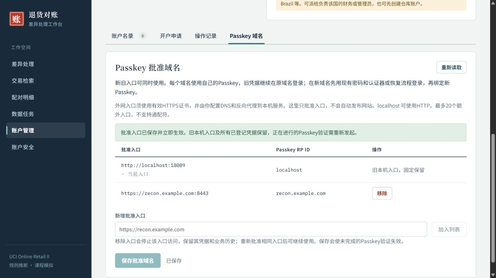

# FR-14/19 Passkey 批准域名与新旧兼容

本人要求管理员管理页面支持设置 Passkey 批准域名，并明确新旧保留兼容。已完成管理入口、持久化、协议与 HTTP 边界校验、自动回归、隔离页面验收及本机 Demo 更新。

## 如何使用

管理员登录后进入“账户管理 → Passkey 域名”。原本机入口固定保留；填写新域名（默认补 HTTPS）或完整 HTTPS 入口，可带端口，先“加入列表”再“保存批准域名”。支持最多 20 个额外入口，重复项归一化，拒绝 IP、通配符、公共后缀、路径、参数、用户信息、非法端口及外网 HTTP。localhost 允许 HTTP。

批准入口后仍需自行配置 DNS、有效 TLS 证书及反向代理到现有 loopback 服务。本轮不发布公网网站、不修改系统 hosts、不申请证书、不放宽监听地址、不设置跨域 CORS。反向代理须保留批准域名的 Host，浏览器请求须带该入口的精确 Origin。

新旧入口同时可用，保存设置不重置旧凭据、会话、恢复码或账户。旧无域名标记的凭据继续按 `localhost` 验证；新凭据记录域名 RP ID，注册、指定账户登录和选择 Passkey 登录都按该 RP 筛选凭据，不能把旧密钥伪装成新域名密钥。相同主机名的不同端口共享 RP ID，但挑战仍绑定发起的精确入口。

不同域名需要分别绑定。若账户仅有旧域名 Passkey，建议先在旧入口登录并添加认证器，再于新入口使用密码＋认证器登录和绑定 Passkey，既有 Passkey 会保留。现有恢复流程仍具有重置认证因素的原有语义，不把恢复重置说成凭据迁移。添加因素后仍按现有安全配置流程保存新的恢复码。

移除额外入口立即阻止其访问，保留该域名凭据；重新批准相同入口后可继续使用。不能从当前入口移除自身，需先切换到本机或其他批准入口。保存设置清除未完成挑战，要求重新发起；不撤销已保存凭据。

WebAuthn 的 RP/Origin 约束参考 [W3C WebAuthn Level 3](https://www.w3.org/TR/2026/REC-webauthn-3-20260825/)。本轮采用每个主机名独立 RP，没有实现跨无关域名共享同一 Passkey 的 related origins 协议。

## 实现与验证

- 新增 `auth_passkey_domains` 单例设置（额外入口 JSON、版本），重复启动保留配置；GET/PUT `/api/admin/passkey-domains` 仅完整 admin 业务会话可用。版本冲突返回 409，变更与追加管理审计同事务，失败整体回滚。
- HTTP 边界读取批准入口，精确匹配 Host；写操作的 Origin 必须与该 Host 的批准入口相同，两个均批准入口也不能互相提交写请求。原 CSRF、用户验证、挑战时效及重放检查继续执行，HTTPS 入口使用 Secure、HttpOnly、Strict、host-only 会话 Cookie。
- 凭据 JSON 增加 `app_rp_id`，旧字段及签名材料保留。显式处理库自身 JSON 解码器，保证元数据不被匿名嵌入解码吞掉。删除账户仅向当前 RP 发送失效通知，其他域名提示手动清理。
- 统一 `test.ps1`：161 项 Go 顶层＋25 项 Python＋11 项前端，共 **197 项通过，0 失败、0 跳过**；生产 TypeScript/Vite/Go 构建通过，生产资源无开发 mock 标记。原始结果见[测试汇总](原始输出/统一测试/summary.json)。
- 新增 TC-67～69 覆盖输入校验、中文域名、管理员/角色/CSRF边界、并发版本冲突、审计失败回滚与挑战保留、重启持久化、新旧密钥两类登录、跨 RP 拒绝、同主机跨端口挑战拒绝、入口移除恢复、HTTPS Cookie、删除通知 RP 隔离。协议使用真实 CBOR/ES256 合成密钥签名，不是认证后门。
- 开发期定向测试发现并修正凭据嵌入解码未读取新增 RP 元数据、静态资源测试的空 Auth 桩兼容；另修正测试中的中文 Punycode 预期和将需业务表的删除断言移入完整 HTTP 夹具。最终统一回归已覆盖这些修复。
- 官方 all 独立副本 `passkey-domains-ui-qa`：真实密码＋TOTP 登录隔离管理员；新增 HTTP 外网入口保存被拒绝，新增 `https://recon.example.com:8443` 保存成功，旧入口固定保留，重新读取仍在；浏览器无控制台错误。截图及[浏览器验收](浏览器验收.json)已归档。这是本地合成配置验收，未声称真实 DNS/TLS 代理或物理 Passkey 跨域设备验收。

## 本机交付

现有 Demo 在 http://localhost:8080 运行，管理员刷新即可看到新分区。二进制 SHA-256：`cbb8f2cbba47e7f3119415afdbc930a4be9239ae73ac7be8a7103f9d43b2b654`；251 项运行文件和入口资源逐项核对通过。

更新前后全部既有计数及只读指纹相同：账户表 5 条、凭据 4 条、恢复码哈希 40 条、差异 9,450 条、配对 14,969 条、业务审计 21,623 条、源行与规范化行各 1,067,371 条、销售余量 1,019,654 条。4 凭据/40 恢复码是本轮更新前已有状态，不能套用上一轮的 5/50。没有删除正式账户、修改正式批准域名或迁入 QA 身份。默认仅批准原本机入口；新增域名由本人从管理页面设置。详见[更新回执](runtime-update.json)，旧程序备份路径保存在回执中。

隔离服务与临时浏览器页已关闭，正式实例保留。仅做本地源码提交；未同步远端、改动中期包/报告/演示，也未重复无新影响的全量对账或性能验收。
