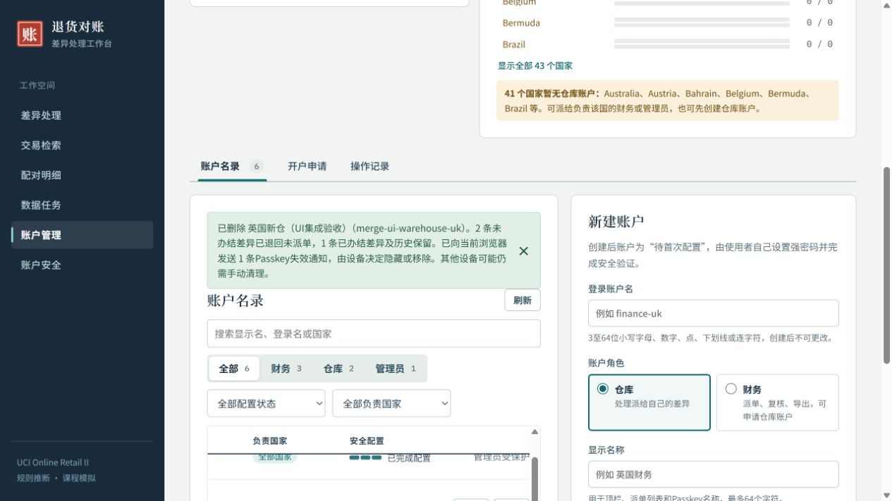

# FR-19 删除账户与 Passkey 失效通知

本轮按本人“支持删除用户，办结结果保留，其余退回未派单，admin不能删除”和随后“加入设备清理提示，不要求保证完全清除”的要求实现。已更新需求、设计和 TC-63～66，并完成本机 Demo 更新。没有删除正式实例中的账户或修改中期材料。

## 使用与保留规则

管理员在“账户管理”点击非管理员账户的“删除”，先查看未办结派单、已办结记录和待审批申请数量，再输入完整登录账户名确认。管理员账户没有删除按钮，后端也拒绝删除任何 admin。finance、warehouse 无权调用删除接口。

删除将未办结差异退回未派单，清空责任人、派单信息及未办结结论，递增记录版本并逐条记审计。已办结记录、历史责任人名称、证据、已保存配对、销售余量和业务审计保留。已确认但未办结的配对可以由新责任人接手办结，不再次消耗数量。被删财务的待审批仓库申请自动驳回，已经批准的仓库及申请历史保留。

账户保留不可登录的历史标识，登录名不重复使用，避免历史记录指向新用户。密码、TOTP、Passkey 服务端登记、恢复码、会话、配置令牌和挑战一并撤销；重复启动不会复活账户。删除、退回、凭据撤销、申请处理和审计同事务提交，任一环节失败全部回滚。已读取的旧派单目标也不能绕过事务内复查。

删除提交成功后，页面对该账户撤销的凭据逐个调用 `PublicKeyCredential.signalUnknownCredential`。通知只针对该账户的凭据，最多等待 2 秒；不支持、拒绝或超时会提示手动清理，不影响已成功的账户删除。通知只触达当前浏览器的凭据提供方，其他设备可能仍需手动清理。成功返回仅表示通知被接受，不代表设备或云同步副本已删除。

参考：[Chrome Signal API 官方文档](https://developer.chrome.com/docs/identity/webauthn-signal-api)。后端仅在事务成功提交后返回失效凭据 ID，不在删除预览、失败响应或管理审计中保存这些 ID。

## 实测与边界

- 统一 `test.ps1`：156 项 Go 顶层测试、25 项 Python、10 项前端，共 191 项通过，0 失败、0 跳过。原始输出和退出码见[统一测试汇总](原始输出/统一测试/summary.json)。首次定向测试因测试请求含未支持字段而失败，修正测试夹具后通过。统一测试外层包装曾因 `$LASTEXITCODE` 未被 .NET 子进程设置而误报失败；三个实际退出码均为 0，测试本身没有失败，未为该误报重复运行。
- 删除专项覆盖角色与 CSRF、admin 保护、旧会话和凭据失效、历史保留、未办结退回、申请自动驳回、保存配对接续、重复和并发删除、旧派单目标、四处注入故障的整体回滚。前端另测通知去重、不支持、拒绝、同步异常、部分成功及超时。
- 生产 TypeScript、Vite、Go 构建成功，生产资源不含开发 mock 标记。此次是管理功能和已有工作流释放事务，未重跑无新影响的全量性能验收，历史性能证据不冒称本轮新成绩。
- 官方 all 独立副本的真实页面验收：输错登录名禁止确认，取消不删除，admin 无删除控件；删除隔离仓库后 2 条未办结退回、1 条已办结保持，账户数 7→6，管理审计 1 条，业务退回审计 2 条；配对及余量指纹不变，其他账户认证材料不变。
- 浏览器实际接受 1 条 Signal API 通知。该测试凭据为无私钥的惰性元数据，仅用于通知路径，未声称验证真实设备删除。页面无控制台错误。详情见[隔离核对](隔离删除核对.json)、[浏览器验收](浏览器验收.json)。

## 本机更新

现有 Demo 已在 http://localhost:8080 启动。二进制 SHA-256 为 `6215ac2420a1512c27c84db4c42e1b7c0da4c5a4e75c6bee07478fb75aa044ef`，251 项运行文件逐项核对通过，入口 JS/CSS 与本次生产构建字节一致。

更新前后正式实例计数与只读指纹完全一致：5 个账户、5 个 Passkey 登记、50 条恢复码哈希、9,450 条差异、14,969 条配对、21,623 条业务审计、1,067,371 条源行及规范化行、1,019,654 条销售余量。此次更新前的业务审计已是 21,623，不能使用此前更新的 21,620 覆盖。原实例、原凭据及业务历史均保留，未迁入隔离测试身份。详细备份路径和更新回执见 [runtime-update.json](runtime-update.json)。

隔离 18089 服务已停止，正式 8080 服务保留。仅完成本地提交，未执行远端同步、课程发送或重制报告、演示与提交包。本人实际设备清理与软件验收仍以本人操作为准。
