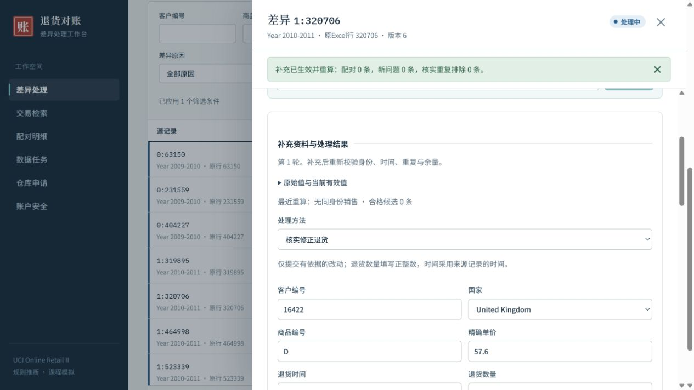

# FR-20 补充重算性能优化

2026-10-20（Asia/Shanghai），实施前提交 a9a28c3。用户要求普通两轮优化后若仍超过10秒，再由一个Astra/xhigh子代理优化两轮；仍超时才采用持久后台队列。随后澄清最终关心的是点击提交到页面全部刷新完成的总耗时。

本轮完成两轮普通优化，达到该门槛，没有启动Astra或新增后台队列。此前首次补充37.211秒的主要成本是复制1067371行并建立九个索引；现在只存变更行，未变更的全部原始规范行仍参与业务有效查询。旧完整投影继续使用原模式，不删历史、不重建正式业务库。

第一轮首次真实同值字段修正含初始化和事务提交2.5112ms，后续两个非幂等生产handler请求3.6171ms/3.1735ms。但有效数据UNION使查询临时物化全量，来源首屏7.339秒、深页8.630秒、差异列表5.553秒、推荐13.969秒。该轮判定存在查询回退，中止自有300HTTP诊断并保留失败记录，没有交付为最终版本。

第二轮改为原始/覆盖两侧主键读取已知ID，优先采用覆盖字段；分页按两侧索引筛选排序，再合并紧凑页键，只补齐当前页来源。计数和候选也拆到索引分支，避免完整身份问题的详情扫描百万行。浏览器首次检查发现候选查询仍慢后，在本轮验证阶段修正；没有用缺字段空候选的快速路径替代页面完成时间。

全量验收还发现官方原价有超过12位小数的正值，旧字段校验会拒绝无关字段的修正。现精确保留这些原值，不舍入；维持64字符输入和输出上限，并将指数绝对值界限设为64，仍拒绝非正、超长或异常指数。新增相关回归。

## 用户关心的完整页面耗时

官方两个年度1067371行隔离副本，生产前端和生产handler，正常强密码/TOTP流程生成的明确模拟财务身份。真实点击“按当前资料重新核查→提交补充并重算”三次，各次请求号不同、问题版本从3递增到6。直到列表、详情、统计和审计的加载提示全部消失，且新版本和结果可见才结束计时。

| 次数 | 点击至全部刷新完成 |
| --- | ---: |
| 1 | 2.642秒 |
| 2 | 2.268秒 |
| 3 | 2.163秒 |

平均2.358秒，最大2.642秒，均小于10秒。包含浏览器自动化操作和快照观察开销，是本机这三次页面实测，不是所有设备、所有业务修改的延迟保证，只按原字段重核，没有伪造官方销售凭证或将未解决问题当作配对成功。

隔离认证库通过正常认证生成测试身份，诊断适配器仅将该身份关联记录及正常登录会话复制到隔离业务副本，以便生产事务内认证校验；原认证行和正式业务库不改，生产认证没有豁免。临时诊断服务已关闭、临时代码移出应用树；诊断源码和认证秘密仅保留在外部隔离目录，不提交秘密。

## 最终技术验证

- 197项Go顶层测试通过，0失败、0跳过。新增稀疏/旧投影迁移、重启、回滚、精确价格以及分页矩阵；六种排序双向、多页/尾页/越界、有效修正、补录和国家/地区/仓库范围与完整导出或独立全结果查询一致。未改前端或Python逻辑，复用此前11项前端和25项Python通过记录。
- 官方源使用store.OpenReadOnlySource驱动只读打开，SHA前后均为7d3fe2d371b307fcdd77d8086dc5a455945e0c9bd254b866af85f2dbf5585aab。原始及有效输入完整1067371行；1019654条销售余额、19164条接纳取消、9715条既有分配、首次决策/汇总及所有余额逐行摘要和数量/金额/重复容量守恒通过。
- 新副本首次字段修正含初始化/提交5.1137ms，随后实际API修正4.5092ms、重核3.1953ms。此次新副本验收随后因旧价格精度校验返回422，证据保留；修复后在同一隔离副本继续最终验证，恢复请求的幂等返回单列，未冒充再次冷启动。
- 最终源码用各原因中相关问题最多的未派单组实测：多个候选13条相关问题，API67.0995ms；余量不足13条，51.0892ms；无同身份销售6条，9.5075ms。均为真实非幂等原字段修正，仍未解决，原问题/责任人保留；补充后容量与分配再次守恒。
- 最终分项：交易首屏1.739ms、倒序3.695ms、深页1.544秒、国家/地区排序筛选3.207秒、详情2.526ms、差异列表8.900ms、总览103.272ms、推荐生成9.540秒。国家/地区筛选和深分页仍未达旧200ms优选，不宣称所有查询毫秒级。
- 本次300并发请求检查明确跳过，首轮中止也未计通过；未重新宣称正式NFR04或其他未复测性能目标。最终验证器总耗时55.375秒包含文件散列、摘要逐行守恒等诊断，不是用户点击后业务等待。

## 本地交付与复现

已更新teacher-demo/app/recon.exe、portable-manifest.json和本机active-build.json；251项便携软件完整性通过，没有创建或重置运行实例。新程序SHA256：e2cb362105c7427ac325552942211dc59b5d3403f722fe8879148efd224dbf1c。当前启动入口下次打开运行新版。

外部构建：%LOCALAPPDATA%/dutucijp-vibecoding-final/builds/fr20-performance-20261020/recon.exe。旧程序和清单保存在同目录before-performance-update。前端生产资源沿用FR-20版本，无页面样式变更。未制作最终报告、PPT或ZIP，未改现有中期演示材料，未向其他聊天发消息或进行远端发布。其他任务的未跟踪文件原样保留。

复现Go：使用已锁定Go运行`go -C backend test -count=1 ./...`。官方验证：`go run ./cmd/remediationverify --source <官方all只读源> --db <verification/fr20-新目录/business.sqlite> --skip-http-load`，恢复仅使用`--resume-isolated`且保留已有固定事件。工具不会提供普通业务绕过入口，不自动操作正式库。

本目录保存完整页面耗时、最终官方结果、Go汇总、查询计划、程序完整性和实际截图。第1轮中止及第2轮价格修复前失败另存；外部原始输出定位见各JSON。官方最终结果的resumed=true以及HTTP负载显式跳过均保留，不改写为全新冷启动或300请求通过。

